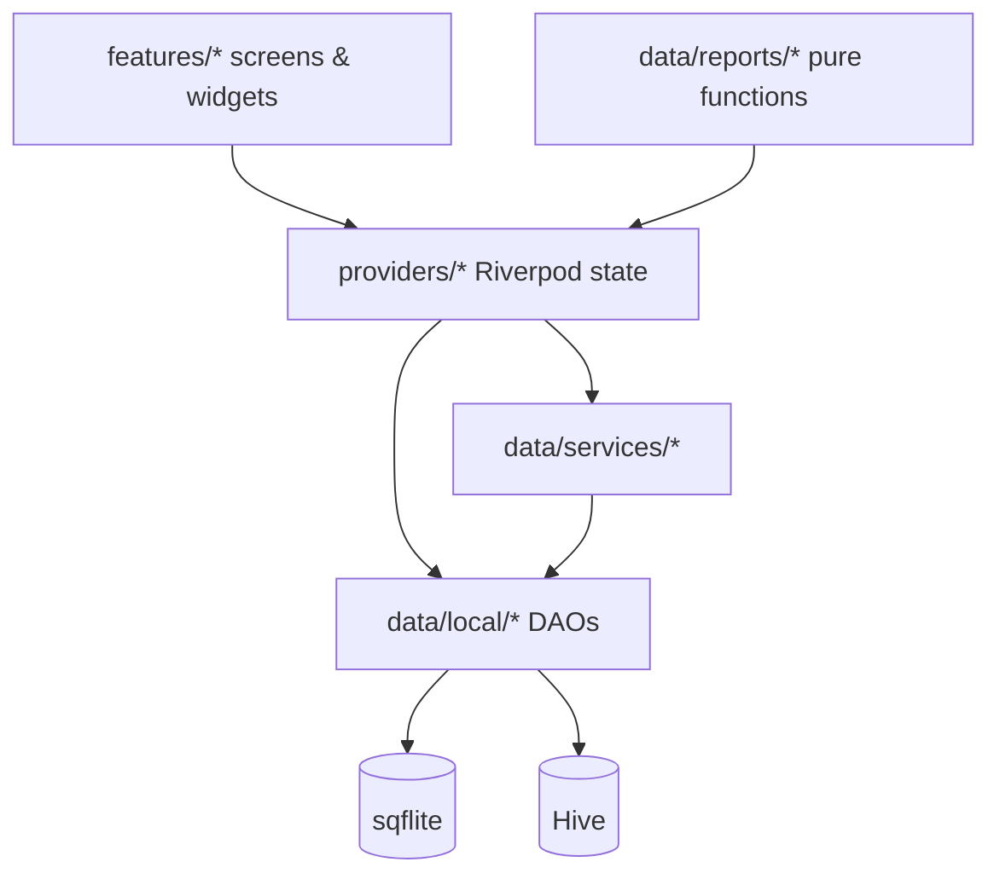

# Walt

A modern, offline-first expense & income tracker for Android, built with
**Flutter** and **Material 3 (M3) Expressive**. Everything lives on-device —
no account, no cloud, no tracking.

Track expenses and income, set per-category budgets with live alerts, visualise
spending in charts, export PDF reports, lock the app with biometrics, and
update in place via over-the-air releases.

[](https://github.com/Abdogouhmad/walt/actions/workflows/ci.yml)
[](https://github.com/Abdogouhmad/walt/releases)
[](LICENSE)


<!-- TODO: add screenshots under docs/screenshots/ and link them here. -->

---

## Features

- **Offline-first** — all data stays on-device (SQLite + Hive). No account, no
  network dependency for the core app.
- **Home dashboard** — balance hero with income/expense breakdown, a weekly
  spending chart, and recent activity.
- **Activity** — transactions grouped by day, search, type/category filters,
  and swipe-to-delete with undo.
- **Add income & expense** — amount, category, account-independent type, date,
  and an optional note.
- **Budgets** — per-category monthly limits with progress bars and
  notifications at 80% and 100% of a limit (once per threshold, per period).
- **Reports** — week / month / year views with a trend chart, a category donut
  and percentage breakdown, and export to a styled PDF via the share sheet.
- **Appearance** — nine built-in palettes plus a custom seed colour,
  system/light/dark mode, an AMOLED pure-black option, and a "reduce
  transparency" toggle.
- **App lock** — optional biometric authentication.
- **Currency conversion** — switch the base currency; stored amounts are
  converted at the live rate.
- **Onboarding** — a short first-run flow for security and profile setup.
- **OTA updates** — a silent background version check with a "What's new"
  changelog and an optional in-app download & install.

## Tech stack

| Concern | Choice |
| --- | --- |
| Language / UI | Dart `^3.11.4`, Flutter (stable), Material 3 |
| State management | `flutter_riverpod` 3 |
| Routing | `go_router` 17 |
| Local database | `sqflite` (+ `sqflite_common_ffi` on desktop) |
| Key-value store | `hive_ce` |
| Models | `freezed` + `json_serializable` |
| Charts | `fl_chart` |
| PDF export | `pdf`, `share_plus`, `path_provider` |
| Notifications | `flutter_local_notifications` |
| Auth | `local_auth` |
| OTA updates | `ota_update`, `http`, `package_info_plus` |
| Other | `intl`, `currency_converter`, `image_picker`, `url_launcher`, `flutter_slidable`, `flutter_markdown_plus` |

## Supported platforms

| Platform | Status |
| --- | --- |
| **Android** | Primary target — all features, including biometrics and OTA install. |
| **Linux** | Desktop build for development and testing (biometric auth is bypassed). |

iOS, web, Windows and macOS are not configured in this repository.

---

## Getting started

### Prerequisites

- **Flutter SDK** (stable channel) with a Dart SDK of `^3.11.4` — run
  `flutter doctor` to confirm your toolchain.
- **Android**: Android Studio (or the Android SDK + command-line tools) and a
  device or emulator.
- **Linux desktop** (optional): the standard Flutter Linux toolchain
  (Clang, CMake, Ninja, GTK dev libraries).

### Run it

```bash
git clone git@github.com:Abdogouhmad/walt.git
cd walt
flutter pub get
flutter run            # add -d linux to run on the desktop target
```

No environment file or API key is required. Generated model code
(`*.g.dart`, `*.freezed.dart`) is committed; regenerate it only when the
models change:

```bash
dart run build_runner build --delete-conflicting-outputs
```

---

## Project structure

```text
walt/
├── android/                 # Android host: signing, manifest, OTA FileProvider
├── assets/                  # Bundled font, launcher icon, in-app images
├── lib/
│   ├── core/
│   │   ├── design/          # Spacing, radius and motion tokens
│   │   ├── theme/           # Material 3 themes, palettes, text scale, colours
│   │   ├── utils/           # Money formatting, context helpers, icons
│   │   └── widgets/         # Shared design-system widgets
│   ├── data/
│   │   ├── local/           # sqflite helper + DAOs, Hive service
│   │   ├── models/          # freezed models (transaction, budget, category, …)
│   │   ├── reports/         # Pure aggregation / date maths
│   │   └── services/        # Notifications, PDF export, image store, OTA,…
│   ├── features/            # auth, onboarding, home, transactions, budgets,
│   │                        #   reports, settings — one folder per screen
│   ├── providers/           # Riverpod providers (state + derivation)
│   ├── shared/              # Cross-feature widgets, buttons, text styles, export
│   ├── app_router.dart      # go_router configuration + redirects
│   └── main.dart            # Bootstrap, platform setup, ProviderScope
├── test/                    # Unit and widget tests
├── update_manifest.json     # OTA release feed (rewritten by CI on release)
└── pubspec.yaml
```

## Architecture overview

Walt uses a pragmatic layered architecture, with features depending downward
and data/state never depending on the UI:



- **UI (`features/`)** renders screens and sends intents to providers. It owns
  no persistence.
- **State (`providers/`)** holds Riverpod notifiers (`Notifier` /
  `AsyncNotifier`) and derived providers. Screens watch narrow slices.
- **Data (`data/`)** contains the sqflite DAOs and the Hive service, plus pure
  aggregation logic in `data/reports/` that is directly unit-tested.
- **Services (`data/services/`)** wrap platform concerns: notifications, PDF
  export, avatar image storage, and the OTA update client.

Routing is declarative via `go_router`. A redirect gate in `app_router.dart`
sequences onboarding, the biometric lock screen, and the main shell based on
persisted settings.

---

## Building for release

Release builds read signing configuration from `android/key.properties`
(keystore path, passwords, alias) — create it locally, or let CI provide the
`WALT_*` secrets. Debug/`flutter run --release` falls back to the debug key.

```bash
# Split-per-ABI release APKs (arm64-v8a, armeabi-v7a)
flutter build apk --release --split-per-abi

# Universal APK
flutter build apk --release

# Play Store bundle
flutter build appbundle --release
```

The full signed release — split APKs, universal OTA APK, checksums and the
`update_manifest.json` rewrite — is produced by the tag-driven pipeline in
`.github/workflows/release.yml` (via `./build.sh`). Release notes for the
GitHub release and the in-app "What's new" pane are extracted verbatim from the
matching section of `CHANGELOG.md`.

## Testing

```bash
dart format .                    # format
dart format --set-exit-if-changed .  # verify formatting (CI)
flutter analyze                  # static analysis (must be clean)
flutter test                     # unit + widget tests
flutter test --coverage          # writes coverage/lcov.info
```

## Contributing

Contributions are welcome — see [`CONTRIBUTING.md`](CONTRIBUTING.md) for the
setup, conventions and pull-request checklist. Bug reports and feature requests
use the templates in [`.github/ISSUE_TEMPLATE/`](.github/ISSUE_TEMPLATE).

## License

Released under the [MIT License](LICENSE).

## Acknowledgements

Built with [Flutter](https://flutter.dev) and powered by
[Riverpod](https://riverpod.dev), [go_router](https://pub.dev/packages/go_router),
[fl_chart](https://pub.dev/packages/fl_chart), [Hive CE](https://pub.dev/packages/hive_ce),
[sqflite](https://pub.dev/packages/sqflite),
[`pdf`](https://pub.dev/packages/pdf), and
[ota_update](https://pub.dev/packages/ota_update). The UI is set in
[Roboto Flex](https://fonts.google.com/specimen/Roboto+Flex) (SIL Open Font
License).
